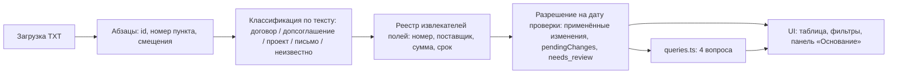

# Записка Product Owner

## 1. Пользователь и задача

Пользователь — специалист по закупкам. Ему нужно ответить, какая сумма и какой срок поставки
действуют по договору на дату проверки, и не перечитывать для этого договор, допсоглашения и
переписку. Каждому ответу он должен верить: значение показывается вместе с файлом, точной
цитатой и переходом к абзацу. Если документ его изменил, рядом видно, каким документом и каким
было исходное значение. Если надёжного ответа нет, показывается «нет данных» или «требует проверки»
вместо догадки.

## 2. Пять вопросов клиенту перед развитием

1. **Откуда и в каком виде приходят документы?** TXT, DOCX, сканы PDF, выгрузка из СЭД или 1С;
   один шаблон договора или десятки шаблонов контрагентов. От ответа зависит, хватит ли правил
   или нужен OCR и модель.
2. **Что считается подписанием и вступлением в силу?** Достаточно ли текста «подписано
   сторонами», или нужна отметка ЭДО/ЭЦП, регистрационный номер или скан с подписями. Кто
   подтверждает, что документ действует?
3. **Какие поля нужны, кроме суммы и срока?** Неустойка, условия оплаты и аванс, этапы
   поставки, валюта, НДС, адрес поставки. И какие вопросы закупщик задаёт чаще всего.
4. **Какова цена ошибки и кто проверяет результат?** Что хуже: пропущенное значение или
   неверное. Должен ли закупщик подтверждать каждое значение, или достаточно выборочной проверки
   спорных.
5. **Где живут договоры и куда должен уходить результат?** СЭД, 1С, SharePoint, почта; нужна
   ли выгрузка в реестр, напоминания о сроках или карточка в учётной системе.

## 3. Допущения

- Дата проверки по умолчанию 10.03.2026, её можно изменить в интерфейсе. От неё зависят
  вступление допсоглашений в силу и порог фильтра по сроку.
- Условия меняет только допсоглашение, которое подписано обеими сторонами и вступило в силу не
  позже даты проверки. Подписанное с будущей датой вступления, проект и письмо поставщика
  показываются отдельно, как ещё не действующие изменения.
- Тип документа определяется по тексту, а не по имени файла. Даты в именах файлов и порядок
  загрузки на результат не влияют.
- Документы написаны в общем формате учебного набора: номер договора в заголовке, нумерованные
  пункты («2.1.», «3.1.»), строка «Статус:», формулировки «изложить в следующей редакции» и
  «вступает в силу». Цена и срок ищутся по смыслу предложения, а не по номеру пункта; номер пункта
  связывает договор с «Пункт N договора изложить…» в допсоглашении. Документ другого формата не
  угадывается: его тип «не распознан», а поля получают «нет данных» или «требует проверки».
- Соседние числа и даты (аванс, доля платежа, лимит, потолок «не более», срок оплаты, дата приёмки)
  не являются суммой договора или сроком поставки. Если суммы нет, показывается «нет данных», а
  строка таблицы получает бейдж «нет данных: <поле>» вместо «ок».
- Конфликт двух действующих допсоглашений, неясный статус подписания, допсоглашение без даты
  вступления в силу, договор-дубль и документ без найденного договора не разрешаются автоматически:
  они получают статус «требует проверки» (`needs_review`) или попадают в блок «Требует проверки».

## 4. Две метрики

**Качество — точность полей на размеченном наборе.** Каждая пара «договор × поле» относится
к одному из классов: *верно* (значение и цитата совпадают с разметкой), *пропуск* (система
ответила «нет данных» или «требует проверки», а значение есть) и *ложное значение* (показано
неверное значение). Ложное значение опаснее всего: закупщик ему верит.
Формулы: `ложные = ложное / всего полей`, `покрытие = верно / всего полей`.
Порог для пилота: ложных значений не больше 0,5 % (цель 0 %), покрытие не ниже
90 % на типовых шаблонах.

**Полезность — доля значений, принятых без открытия исходника.**
`принято_без_открытия = значения, подтверждённые без перехода к полному тексту / все показанные значения`,
в паре с медианным временем сверки одного договора (было ↔ стало).
Порог: не меньше 70 % принятых без открытия и время сверки в 3 раза меньше ручного. Если значения
часто открывают, а ложных нет, значит, не хватает доверия к цитате, и интерфейс основания нужно
улучшать.

## 5. Архитектура

- Приложение — SPA на Vite, React и TypeScript, без бэкенда. Файлы не покидают браузер.
- Движок `src/engine` — чистый TS без React и сети. Точка входа:
  `analyze(files, checkDate) → AnalysisResult`, дата — строка `YYYY-MM-DD` из поля «Дата проверки»;
  не действующие изменения лежат в `pendingChanges` с причиной и цитатой.
- Каждое значение хранит статус (`ok` / `no_data` / `needs_review`) и основание: файл, id абзаца,
  точную цитату и смещения. Тест проверяет, что цитата совпадает с подстрокой исходного текста.
- Новое поле (например, ставка неустойки) — это один файл извлекателя, его регистрация в реестре и
  тест.

## 6. Три ключевых решения и компромиссы

1. **Правила вместо LLM.** Правила детерминированы, дают точную цитату и честное «нет данных», не
   требуют платного API и проверяются тестами. Компромисс: они работают только на общем формате;
   другая нумерация пунктов или свободная формулировка уходит в «требует проверки», а не
   распознаётся.
2. **Клиентское SPA без бэкенда.** Запуск одной командой, документы не уходят на сервер. Компромисс:
   нет хранения, общего доступа, истории и прав; объём ограничен памятью браузера, поэтому решение
   подходит для десятков документов, а не для тысяч.
3. **Только подписанное и вступившее в силу допсоглашение плюс флаг «требует проверки».**
   Неоднозначные случаи система не разрешает догадкой, а показывает человеку. Это снижает риск
   ложного значения. Компромисс: при плохих данных растёт ручная работа, и часть ответов звучит
   как «проверьте сами».

## 7. Что изменится при 100 000 документов и правах доступа

- **Серверный конвейер:** загрузка из СЭД или хранилища, очередь извлечения и фоновые воркеры
  вместо разбора в браузере.
- **Хранилище абзацев и индекс:** абзацы со смещениями и извлечённые поля в БД, полнотекстовый
  индекс для поиска по номеру, контрагенту и формулировке; вопросы работают по индексу, а не по
  повторному разбору.
- **Версии документов:** повторная загрузка создаёт новую версию, а результат пересчитывается
  только для затронутого договора. Видно, какая версия дала значение.
- **Гибрид правила + модель:** правила для известных шаблонов, модель для нетиповых форматов. Её
  ответ принимается только с цитатой, которая точно совпадает с текстом, и с низкой уверенностью
  уходит в «требует проверки». Метрика ложных значений считается отдельно для каждого пути.
- **Права доступа:** ACL на уровне договора и контрагента, наследуемые допсоглашениями и
  письмами. Поиск и вопросы фильтруются по правам до выдачи результата.
- **Аудит:** журнал того, кто что открыл и подтвердил, и какое значение было показано на какую
  дату.

## 8. Три следующих улучшения (по приоритету)

1. **Размеченный набор и замер метрик качества.** Без него нельзя доказать, что ложных значений нет,
   и безопасно расширять правила. Это основа для двух следующих пунктов.
2. **Поддержка реальных шаблонов клиента и DOCX/PDF с текстовым слоем.** Это главный ограничитель
   применимости. Делать его до замера метрик нельзя: регрессию нечем будет поймать.
3. **Подтверждение значения закупщиком и экспорт реестра.** Это превращает просмотр в рабочий
   процесс и даёт данные для метрики полезности. Пункт ценен только когда значения надёжны на
   реальных документах, поэтому стоит третьим.
